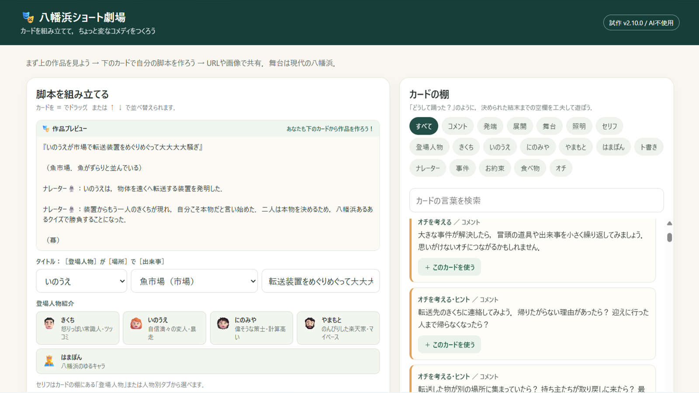
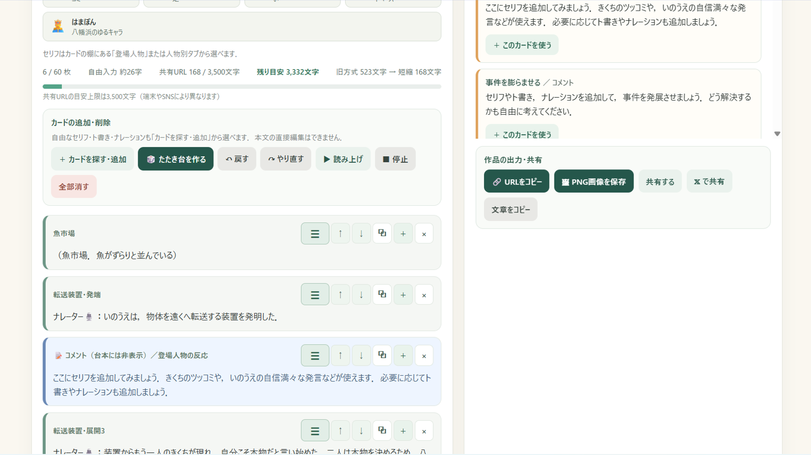

# ConteCraft（八幡浜ショート劇場）🎭

**カードを並べて、八幡浜を舞台にした小さな物語をつくる。**

ConteCraft（コンテクラフト）は、登場人物のセリフや舞台、照明、演出などのカードを組み合わせて、ショートコントや短い劇の脚本を作るWebアプリです。

文章を一から書き始めなくても、カードを選んで並べ替え、必要な部分だけ書き足すことで物語を作れます。舞台は愛媛県八幡浜市。地元の風景や名物も、物語の材料になります。

**▶ [ConteCraftを使ってみる](https://katabomb.github.io/ConteCraft/index.html)**

## アプリの画面

画面上部の作品プレビューを見ながら、カードの棚からセリフや舞台などを追加して脚本を組み立てます。

## ほかのサンプルシナリオ

アプリを開くと、最初から『三体星人を呼ぶ』がサンプルとして表示されます。ほかにも、次の作品を用意しました。

- **[開けてはいけない箱をめぐって大騒ぎ](https://katabomb.github.io/ConteCraft/#s=WzIsMywxMywi6ZaL44GR44Gm44Gv44GE44GR44Gq44GE566x44KS44KB44GQ44Gj44Gm5aSn6aiS44GOIixbInUiLCJERSIsWyJCVSIsIumWi-OBkeOBpuOBvyJdLFsiQlciLCLjgYTjgoTvvIzoqrDjga7jgYvjgoLnn6XjgonjgpPjgZciXSxbIkJVIiwi56eB44Gu44KE44GX77yO6ZaL44GR44Gm5Lit44KS5Ya36JS15bqr44Gr44GX44KC44GG44Go44GL44KT44Go44GE44Gf44KA44KIIl0sWyJCVyIsIuODiuODnuODouODju-8nyJdLFsiQlYiLCLjgYLjgYLvvIzjgZPjgozvvJ_ml6njgY_plovjgZHjgabjgrnjgqTjg4Pjg4HliIfjgonjgarjgYTjgajkuK3ouqvjgYzpo5vjgbPlh7rjgZnjgogiXSxbIkJXIiwi44K544Kk44OD44OB77yf5qmf5qKw44Gq44Gu77yfIl0sWyJCVCIsIuacrOW9k-OBr-ODiuODjuODnuODhuODquOCouODq-OBruWIgOOBoOOCiO-8juOBhOOBhOOBi-OCieaXqeOBj-mWi-OBkeOBquOBleOBhCJdLCJCTCIsIkJKIixbIkJYIiwi5a6f44Gv44KP44Gf44GP44GX77yM44G_44Gq44GV44KT44Gr44OG44Os44OR44K344O844KS6YCB44Gj44Gm5oSP6K2Y44KS5pON44Gj44Gm44GK44KK44G-44GX44Gf77yO5YWr5bmh5rWc44Gu6YeN6KaB5qmf5a-G44KS5L-d6K2344GZ44KL44Gf44KB44Gu5o6q572u44Go44Gv44GE44GI55Sz44GX6Kiz44GU44GW44GE44G-44Gb44KT77yO44GX44GL44KC44OG44Os44OR44K344O844GM5re357ea44GX44Gm5LqL5oWL44GM44GV44KJ44Gr5re35Lmx44GX44Gf44GT44Go44Gv55eb5oGo44Gu5qW144G_44Gn44GZIl0sWyJCWCIsIue1kOaenOeahOOBq--8jOOChOOBvuOCguOBqOanmOOBq-OBr-euseOCkue1tuWvvumWi-OBkeOBquOBhOOCiOOBhuOBq--8jOOBhOOBruOBhuOBiOanmOOBq-OBr-euseOBruS4reOBq-OBr-WFq-W5oea1nOOBrumvm-OBl-OCg-OBtuOCu-ODg-ODiOOBjOWFpeOBo-OBpuOBhOOCi-OBteOBhuOBq--8jOOBq-OBruOBv-OChOanmOOBq-OBr-S6jOWuruOBpOOBquOBjOOCiuOBp-S6jOWuruW_oOWFq-e_geOBruOCq-ODqeOCueWei-ODieODreODvOODs--8jOOBneOBl-OBpu-8jOOBjeOBj-OBoeanmOOBq-OBr-OBquOBnOOBi-ODleODqeOCpOODs-OCsOODluODrOODvOODieOBruOCpOODoeODvOOCuOOCkumAgeOBo-OBpuOBl-OBvuOBhOOBvuOBl-OBn--8juOBpOOBj-OBpeOBj-aCquOBi-OBo-OBnyJdLFsiQlQiLCLjg4rjg47jg57jg4bjg6rjgqLjg6vjgaDjgZHplqLkv4LjgarjgZXjgZnjgY7jgoTjgo3vvIHjgajjgZPjgo3jgafvvIzjga_jgb7jgb3jgpPvvIzjgYrliY3kuIDkvZPkvZXogIXjgarjgpPjgoTvvJ8iXSxbIkJYIiwi5a6f44Gv44KP44Gf44GP44GX77yM5YWr5bmh5rWc44Gu6YeN6KaB5qmf5a-G44KS5a6I44KL44Gf44KB44Gr4oCm4oCmIl0sWyJCVCIsIuOBneOCjOOBr-OCguOBhuiBnuOBhOOBn--8gSJdLFsiQlgiLCLigKbigKbjgajjgYTjgYboqK3lrprjga7oprPlhYlQUuOCreODo-ODqeOCr-OCv-ODvOOBp-OBmSJdLFsiQlQiLCLoqK3lrprjgYzph43jgZnjgY7jgovjgo_vvIEiXV1d)** — 開けてはいけない箱を前に、登場人物たちが騒動を繰り広げます。
- **[奇妙な光をめぐって大騒ぎ](https://katabomb.github.io/ConteCraft/#s=WzIsMSwxNywi5aWH5aaZ44Gq5YWJ44KS44KB44GQ44Gj44Gm5aSn6aiS44GOIixbIkNGIiwieSIsIkMwIixbIkJaIiwiNOS6uuOBr-OBneOBruWFieOCkuimi-OCi-OBn-OCgeOBq-WxseOBq-eZu-OBo-OBnyJdLCIyIiwiQkYiLCJCSSIsWyJCVyIsIuOBguOBneOBk-OChOOBrSJdLFsiQloiLCLlsbHjga7mlpzpnaLjgYvjgonlsJHjgZfpm6LjgozjgZ_jgajjgZPjgo3jgavjg5zjgqbjgaPjgajjgZfjgZ_lhYnjgYzopovjgYjjgosiXSwiOCIsWyJCVSIsIuOBk-OCjOOBr-Wuh-WumeaWh-aYjuOBi-OCieOBruODoeODg-OCu-ODvOOCuOOChO-8geS7iuOBruOBhuOBoeOBq-S4gOeVquS7suiJr-OBj-OBquOBo-OBqOOBk--8gSJdLCJDMyIsWyJCWiIsIui1sOOCiuabuOOBjeOBl-OBn-ODoeODouOCkuS4uOOCgeOBpu-8jOWFieOBq-WQkeOBi-OBo-OBpuaKleOBkui-vOOCk-OBp-OBhOOCiyJdLCIzIixbIkJaIiwi44GE44Gu44GG44GI44Gv44CB44OQ44OD44Kw44KE44Od44Kx44OD44OI44Gu5Lit6Lqr44G-44Gn5oqV44GS6L6844G_5aeL44KB44GfIl0sWyJCVSIsIuWcsOeQg-OBi-OCieOBrui0iOOCiueJqeOChO-8gSJdLFsiQlYiLCLjgbXjgYXvvIzjgbXjgYXigKYiXSxbIkJaIiwi44Gy44Go6Laz6YGF44KM44Gm77yM44Gr44Gu44G_44KE44GM55m744Gj44Gm44GN44GfIl0sWyJCVSIsIuOBq-OBruOBv-OChOOBoeOCg-OCk--8jOOCiOOBj-eZu-OCjOOBvuOBoeOBn-OBreOAnO-8juWFq-W5oea1nOOBruOBmOODvOOBmOODvO-8iOmtmu-8ieOAgemjn-OBueOBvuOBoeOCheOBi-OAnO-8nyJdLFsiQlYiLCLotaTjgaHjgoPjgpPmibHjgYTjgZnjgarvvIHigKbjgafvvIzkvZXjgZfjgabjgovjga7vvJ8iXSxbIkJaIiwi44KE44G-44KC44Go44Gv77yM44GT44KM44G-44Gn44Gu57WM57ev44KS44Gr44Gu44G_44KE44Gr6Kqs5piO44GX44GfIl0sWyJCViIsIuODkOOCq-OBreOBiOOAgeOBneOCjOOBr--8jOODkeODgeODs-OCs-Wxi-OBi-OCieepuuOBq-WQkeOBi-OBo-OBpuaUvuOBn-OCjOOBn-OCteODvOODgeODqeOCpOODiOOBjO-8jOmcp-OBq-WPjeWwhOOBl-OBpu-8jOWLleOBhOOBn-OCiueCuea7heOBl-OBn-OCiuOBl-OBpuimi-OBiOOBpuOBhOOCi-OBruOCiCJdLCJCRiIsWyJCWiIsIjTkurrjga_vvIznlrLjgozmnpzjgabjgablsbHjgpLpmY3jgorjgabjgYTjgaPjgZ8iXSwiQlIiLFsiQloiLCLjga_jgb7jgb3jgpPjga_vvIznqbrjgYvjgonoibLjgIXjgarjgoLjga7jgYzpmY3jgaPjgY_jgovjga7jgpLvvIzlj6PjgpLplovjgYTjgabopovkuIrjgZLjgabjgYTjgZ_vvI4iXSwiQkoiLFsiQloiLCLmrKHjga7nnqzplpPvvIzpo5vjgpPjgafjgY3jgZ_jg5rjg7Pjg6njgqTjg4jjgpLjgYbjgaPjgYvjgorpo7Ljgb_ovrzjgpPjgafjgZfjgb7jgaPjgZ_vvIHlhYnjgovjgYrohbnvvIHvvIEiXSxbIkJYIiwi44G944KT44G944KTIl1dXQ)** — 山で目撃された謎の光をめぐる、ちょっと不思議な物語です。

リンクを開くと、その作品がConteCraftに読み込まれます。カードを並べ替えたり、セリフを追加したりして、自分なりの展開やオチに作り変えてみてください。**作品データがURLに含まれている**ため、専用の保存サーバーは必要ありません。

## こんなことができます

- **カードで脚本を組み立てる**：人物のセリフ、ナレーション、舞台、照明、演出などを組み合わせます。
- **自由に編集する**：カードの追加・削除・並べ替えや、セリフなどの自由入力ができます。
- **たたき台から始める**：物語のきっかけや展開を選んで、創作の出発点にできます。結末は自分で考えられます。
- **読み上げる**：ブラウザの音声読み上げ機能で、セリフやナレーションを聞けます。
- **作品を持ち出す**：文章のコピー、PNG画像の保存、URLによる共有ができます。
- **URLを渡して続きを作る**：共有された作品を開き、編集して、再びURLで渡せます。

## 使い方

1. 上のリンクからアプリを開きます。
2. カードの棚から使いたいカードを選び、作品に追加します。最初は「🎲 たたき台を作る」から始めることもできます。
3. カードの順番を変えたり、セリフを編集したりして脚本を仕上げます。
4. 「▶ 読み上げ」で流れを確かめます。
5. 完成したら、URL・PNG画像・文章で共有します。

**ヒント：** URLで共有すると、受け取った人もその作品を編集できます。作品のURLを保存しておけば、後から続きを作ることもできます。

### カードの編集と作品の共有

カードは並べ替え・複製・削除でき、自由入力カードには好きなセリフを書けます。完成した作品はURLやPNG画像で共有できます。

## ConteCraftの特徴

### 1. AIを使わずに物語を作る

物語を自動生成AIに書かせるアプリではありません。用意されたカードやたたき台をきっかけに、**作者自身が組み合わせ、考え、脱線し、オチをつける**ことを楽しむ道具です。

### 2. 八幡浜が舞台

八幡浜の場所、食べ物、方言、地域の話題を、コントやSF、冒険などに取り入れられます。地元を知っている人にも、知らない人にも、物語を通じて八幡浜に親しんでもらうことを目指しています。

### 3. 単一HTMLファイルで動く

アプリ本体は **HTMLファイル1つ**。特別なサーバー側プログラムやデータベースを用意しなくても、ブラウザで利用できます。

### 4. 共有URLが作品データを兼ねる

作品の内容をURLに埋め込む仕組みを採用しています。専用アカウントや作品保存サーバーを使わずに、URLを送るだけで脚本を受け渡せます。

※ 作品が長い場合はURLも長くなります。共有先のサービスによってはURLの長さに制限があるため、その場合は画像や文章での共有を利用してください。

## 動作環境

JavaScriptが有効な一般的なWebブラウザでの利用を想定しています。音声読み上げ、共有メニュー、画像保存などの挙動はブラウザや端末によって異なる場合があります。

## ソースコードと使い方

このリポジトリにはConteCraftのHTMLファイルを公開しています。アプリを試すだけなら、上の公開ページを開けばOKです。

手元で動かしたい場合は、`index.html` をダウンロードしてブラウザで開いてください。改良したい場合は、HTML・CSS・JavaScriptを編集できます。

## このプロジェクトについて

ConteCraftは、カードを使って誰でも気軽に物語を作れるようにするための個人制作プロジェクトです。完成した脚本だけでなく、**思いつきが思わぬ方向に転がっていく創作の過程**も楽しんでもらえたらうれしいです。

---

**アプリ：** [ConteCraft（八幡浜ショート劇場）](https://katabomb.github.io/ConteCraft/index.html)

**制作：** katabomb

※ ライセンスについては、このREADMEでは指定していません。再利用・改変・再配布の条件を明示する場合は、別途 `LICENSE` ファイルを用意してください。
